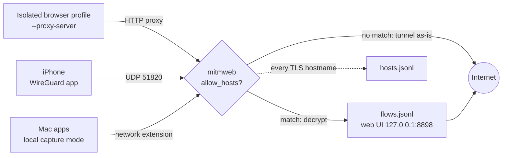

# mitmproxy

Every setup runs as a throwaway **session**: one directory holding its own CA, WireGuard keys, web password and captures. Teardown is "stop, undo trust, delete the directory", and `~/.mitmproxy` is never touched.



## Rules

- Decrypt only what the user asked for. `session.sh` refuses to start without `--allow-hosts`, because an empty allow list means *decrypt everything*. Use `--allow-hosts '(?!)'` to decrypt nothing while discovering domains.
- Ask before any step that changes system-wide trust or networking: the System keychain, the macOS proxy settings, or approving a network extension.
- The session directory holds session cookies, auth tokens, a CA private key and WireGuard keys. Keep it outside git repos and delete it during teardown. `session.sh` creates it with mode 0700.
- Don't print cookie, `authorization` or `csrf-token` values in full.
- Port 8080 is often already taken on this machine. Use 8899 for the proxy and 8898 for the web UI (`MITMWEB_PORT`).

## Session tooling

```bash
SKILL=~/.agents/skills/mitmproxy/scripts
"$SKILL/session.sh" start ~/Developer/<target>-mitm <mode args> --allow-hosts '<regex>' [--allow-hosts ...]
"$SKILL/session.sh" stop ~/Developer/<target>-mitm
```

- **`start`** creates the directory (it must not exist yet), runs mitmweb with `scripts/capture.py`, and prints the web UI URL including its token. Show the user that URL.
- **`stop`** stops mitmweb and `DIR/browser.pid`, but only after checking that each process belongs to the session. It fails if the session CA is still trusted in the System keychain.
- **`allow_hosts` patterns** are case-insensitive Python regexes matched against `host:port`. Anchor them so lookalike hosts don't match: `(^|\.)example\.com(:\d+)?$`.

`scripts/mitmweb_api.py --session DIR <command>` reads the password and port from the session:

| Command | Does |
|---|---|
| `allow-hosts [PATTERN ...]` | Validate the patterns, then replace `allow_hosts` live. With no arguments, show it. |
| `log` | mitmweb's event log. `DIR/mitmweb.log` stays empty while mitmweb runs, because the Homebrew binary buffers stdout. |
| `wireguard-conf` | Print the WireGuard client config. |
| `wireguard-qr OUT.png` | Write that config as a QR code. |

- **Live changes** apply only to new connections, so the user has to restart the app or toggle the tunnel. Avoid the UI's options editor for `allow_hosts`: an invalid regex there is accepted, and then every new connection hangs.
- **Finding the target's domains:** have the user exercise the app, then read `hosts.jsonl`. It has a line for every TCP TLS connection, including ones that weren't decrypted:
  ```bash
  jq -r .host DIR/hosts.jsonl | sort | uniq -c | sort -rn
  ```
  It misses QUIC/HTTP/3 and non-TLS traffic. In Setup B, the phone's DNS lookups also show up in the web UI. An empty list doesn't prove the app made no requests.

## Setup A: isolated browser

Best for websites. Logins and system trust stay untouched. The user has to log in again inside the throwaway profile.

```bash
D=~/Developer/<target>-mitm
"$SKILL/session.sh" start "$D" --mode regular@127.0.0.1:8899 --allow-hosts '<regex>'
SPKI=$(openssl x509 -in "$D/conf/mitmproxy-ca-cert.pem" -pubkey -noout \
  | openssl pkey -pubin -outform der | openssl dgst -sha256 -binary | base64)
/Applications/Helium.app/Contents/MacOS/Helium \
  --user-data-dir="$D/browser-profile" \
  --proxy-server=http://127.0.0.1:8899 \
  --ignore-certificate-errors-spki-list="$SPKI" \
  --disable-quic --no-first-run 'https://<site>/' >/dev/null 2>&1 &
echo $! > "$D/browser.pid"
```

- `--ignore-certificate-errors-spki-list` trusts the session CA only in this profile, and only together with `--user-data-dir`.
- `--disable-quic` keeps HTTP/3 from bypassing the proxy.
- Any Chromium-family browser works. Helium is the default here.

## Setup B: iPhone over WireGuard

Captures phone traffic routed into the tunnel, including apps that ignore proxy settings.

```bash
"$SKILL/session.sh" start "$D" --mode wireguard --allow-hosts '^mitm\.it(:\d+)?$'
"$SKILL/mitmweb_api.py" --session "$D" wireguard-conf | grep Endpoint
"$SKILL/mitmweb_api.py" --session "$D" wireguard-qr "$D/wireguard-qr.png" && open "$D/wireguard-qr.png"
```

1. **Endpoint:** it must be the Mac's LAN IP (`ipconfig getifaddr en0`) on port 51820, with the phone on the same network. Don't pass `--listen-host 127.0.0.1`: it also applies to WireGuard and turns the endpoint into `127.0.0.1`.
2. **Onboarding:** keep `mitm.it` allowed until the certificate is installed, because the onboarding page is served through the proxy.
3. **Steps for the user:**
   - Install the WireGuard app, add a tunnel from the QR code, and turn it on.
   - Turn off iCloud Private Relay and other VPNs, such as Tailscale. Note what was on so it can be restored.
   - In Safari, open `http://mitm.it` and download the iOS profile.
   - Settings → General → VPN & Device Management → install the profile.
   - Settings → General → About → Certificate Trust Settings → turn on full trust for mitmproxy.
4. **IPv6:** the generated config routes only IPv4 (`AllowedIPs = 0.0.0.0/0`). On IPv6 networks some traffic may bypass the tunnel.

Each session has a new CA, so the phone needs a new profile every session.

## Setup C: the Mac's own apps (local capture mode)

```bash
"$SKILL/session.sh" start "$D" --mode local --allow-hosts '<regex>'           # all processes
"$SKILL/session.sh" start "$D" --mode local:Slack --allow-hosts '<regex>'     # processes named Slack (or a PID)
"$SKILL/session.sh" start "$D" --mode 'local:!Helium' --allow-hosts '<regex>' # everything except Helium
```

1. **Ask first.** The first run installs `/Applications/Mitmproxy Redirector.app`, and the user must approve its network extension in System Settings. It can conflict with Tailscale or a corporate VPN, so suggest testing with those off.
2. **Ask first.** Most Mac apps check certificates against the System keychain:
   ```bash
   sudo security add-trusted-cert -d -p ssl -k /Library/Keychains/System.keychain "$D/conf/mitmproxy-ca-cert.pem"
   ```
3. Tools with their own trust store need a bundle with the system roots *plus* the session CA. A bundle with only the session CA breaks every host that passes through undecrypted:
   ```bash
   cat /etc/ssl/cert.pem "$D/conf/mitmproxy-ca-cert.pem" > "$D/ca-bundle.pem"
   ```

   | Tool | How |
   |---|---|
   | Node | `NODE_EXTRA_CA_CERTS="$D/conf/mitmproxy-ca-cert.pem"` (adds to the built-in roots) |
   | Python requests | `REQUESTS_CA_BUNDLE="$D/ca-bundle.pem"` |
   | Python httpx, `ssl` module | `SSL_CERT_FILE="$D/ca-bundle.pem"` |
   | curl, OpenSSL tools | `--cacert "$D/ca-bundle.pem"` or `SSL_CERT_FILE=...` |
   | Firefox | Import the CA in Firefox's certificate settings. Teardown must remove it. |
   | Java | `keytool -importcert -alias mitmproxy-session` into the JVM's cacerts. Teardown must remove it. |
   | Chromium, Electron, Go, Swift apps | Use the keychain, so nothing extra is needed. |

**Lighter option for one CLI tool:** skip local mode and the keychain. Use Setup A's `--mode regular@127.0.0.1:8899` and start only that process with `HTTPS_PROXY=http://127.0.0.1:8899 HTTP_PROXY=http://127.0.0.1:8899` plus the CA variable from the table.

## Reading captures

Each line of `DIR/flows.jsonl` is one decrypted, in-scope HTTP flow:
- `ts`, `client`, `method`, `url`, `http_version`
- `status` and `error`: one of them is null.
- `request_headers` and `response_headers`: lists of `[name, value]` pairs, because cookies repeat.
- `request_body` and `response_body`: either null or `{bytes, truncated, text}`. `text` is UTF-8, up to 20 MB, and null for binary bodies.

- **Scope:** `capture.py` re-checks `allow_hosts` for every request, because mitmproxy applies it per connection and doesn't apply it to plain HTTP in regular mode. The web UI and an opt-in `--set save_stream_file=+DIR/flows.mitm` dump are *not* filtered this way.
- **Not recorded:** WebSocket messages. Use the web UI for those.
- **Filtering:** use `jq` or Python by host, path or time window. Skip static assets unless they're the target.
- **Octet-stream:** `application/octet-stream` is often still text, for example RSC streams, protobuf-JSON or NDJSON. Check `text` before assuming it's binary. RSC (Next.js-style) streams are `id:JSON` lines, with visible text in `children` arrays, often under `textProps`.

## Known limits

- **Certificate pinning:** apps that pin certificates fail to connect. This includes most Apple services, banking apps, and some large apps. `mitmweb_api.py log` shows the TLS handshake failures. Without a jailbreak or a re-signed app there is no workaround; report it.
- **Private Relay and VPNs** on the client bypass or break the capture.
- **Existing connections** keep their decrypt-or-pass decision. Restart the app after changing `allow_hosts`.

## Teardown

Order matters: trust has to be undone while the session CA file still exists.

1. **Setup B:** tell the user to turn off and delete the tunnel in the WireGuard app, and to remove the profile under Settings → General → VPN & Device Management → mitmproxy → Remove Profile. Also restore Private Relay and any VPN they turned off.
2. **Setup C:** undo the trust, check it's gone, and tell the user to remove the Redirector:
   ```bash
   sudo security remove-trusted-cert -d "$D/conf/mitmproxy-ca-cert.pem"
   sudo security delete-certificate -Z "$(openssl x509 -in "$D/conf/mitmproxy-ca-cert.pem" -noout -fingerprint -sha256 | cut -d= -f2 | tr -d :)" /Library/Keychains/System.keychain
   ```
   Remove any Firefox or Java imports (`keytool -delete -alias mitmproxy-session`). Ask the user to turn off the Mitmproxy Redirector in System Settings → General → Login Items & Extensions and to delete `/Applications/Mitmproxy Redirector.app`.
3. Run `"$SKILL/session.sh" stop "$D"`. It refuses to finish while the session CA is still in the System keychain.
4. Run `rm -rf "$D"`.
5. **Setup A:** if the user logged in, suggest signing that session out on the site.
